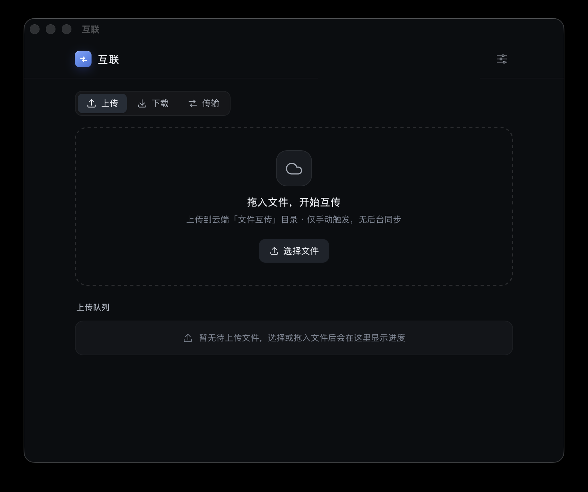
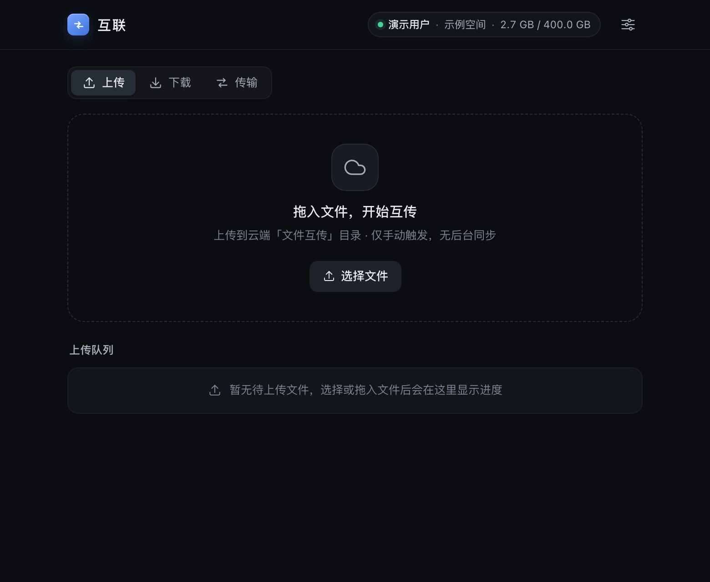
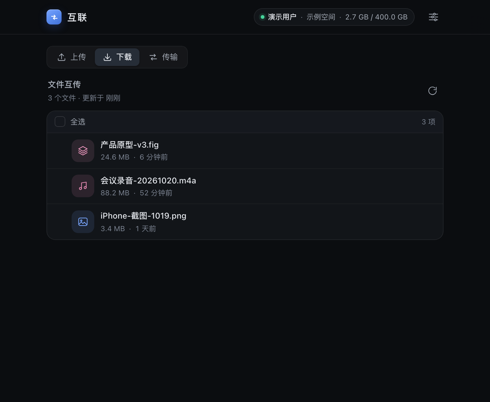
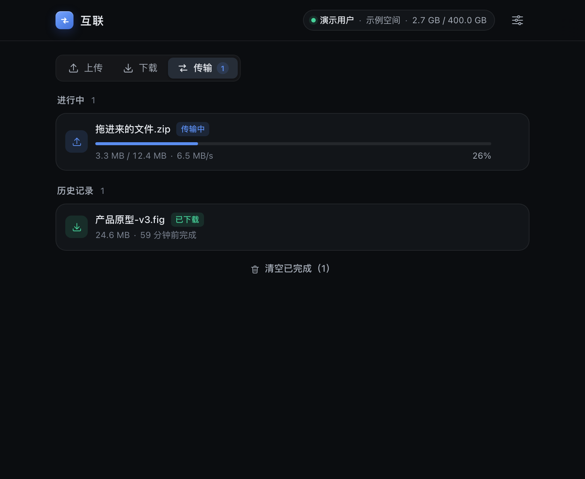
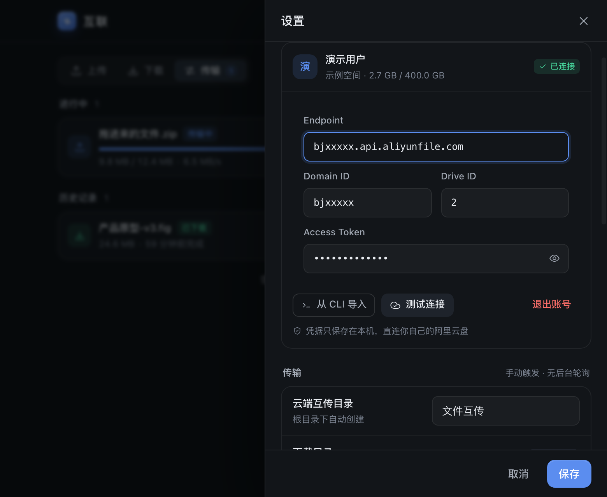
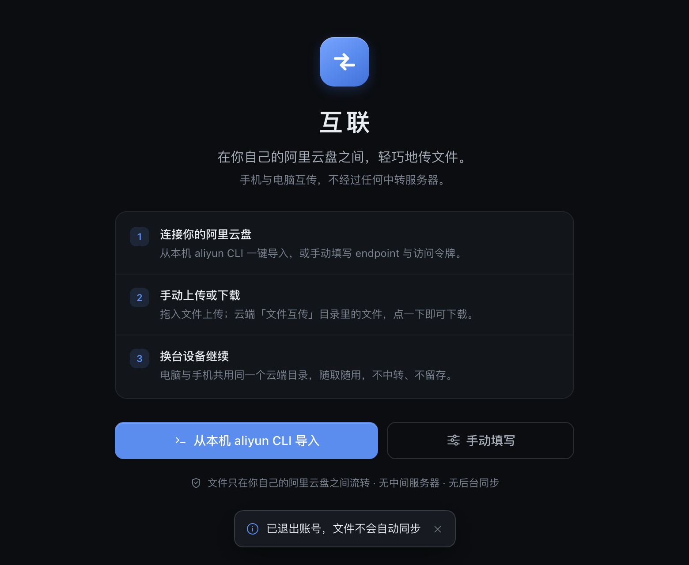
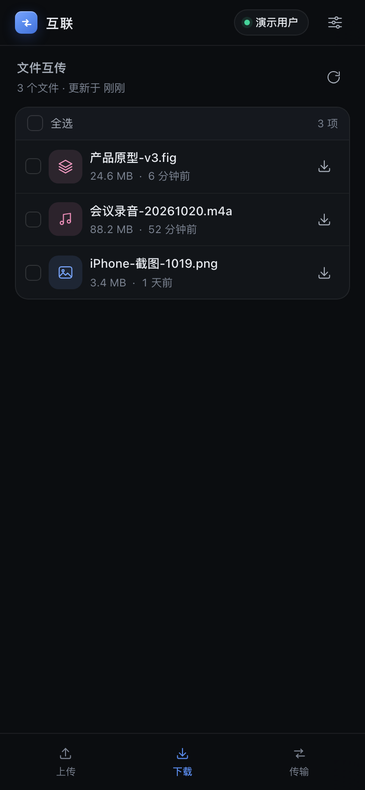
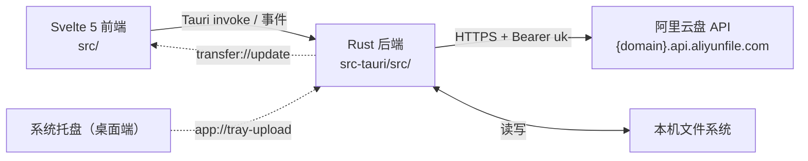

# 互联 · LinkUp

[](https://github.com/qq2243912886-art/hulian/actions/workflows/build.yml)
[](https://github.com/qq2243912886-art/hulian/releases)

> 轻量跨端文件互传：只在你想传的时候，才传。

「互联」是一个基于 [Tauri 2](https://tauri.app/) 的跨端文件互传小工具，覆盖 **macOS / Windows / Android** 三端。
它把文件放进**你自己的阿里云盘（个人版）**根目录下的固定目录「文件互传」，另一台设备打开同一目录就能下载。

没有账号体系、没有中转服务器、没有同步、没有后台轮询——只有你手动点的那一下。

> 当前版本 **0.1.0**。macOS 构建已在本机跑通；Windows / Android 的构建流程已脚本化并接入 CI，但尚未在本机逐项实机验证（详见 [构建与发布](docs/构建与发布.md) 的「验证状态与未验证项」）。

---

## 它是什么 / 不是什么

| 是 | 不是 |
| --- | --- |
| 手动触发的上传 / 下载 | 文件同步（不监听本地目录、不自动上传） |
| 分片上传、断点续传下载 | 后台轮询、目录扫描、常驻网络连接 |
| 桌面端托盘常驻、空闲近零占用 | 网盘客户端 / 文件管理器 |
| 数据只经过你自己的阿里云盘 | 经过第三方中转服务器 |

**「无同步」是设计选择，不是缺失**：不监听文件变化、不扫描目录、不在后台定时拉取云端列表。
只有你点击「上传 / 下载 / 刷新」时才会发生网络请求。

## 亮点

- **轻**：Tauri 2 复用系统 WebView（macOS WKWebView / Windows WebView2 / Android System WebView）。实测（macOS 0.1.0）：App 包 5.3 MB、dmg 2.7 MB；**托盘常驻时活动监视器「内存」仅约 15 MB**（进程内无 WebView、无定时器、CPU 0%），打开窗口约 31 MB。
- **桌面端托盘常驻**（默认设置）：桌面端主窗口不在启动时创建（`create: false`），托盘模式完全不实例化 WebView；关闭窗口 = 销毁窗口与 WebView，只保留托盘，点击托盘再按需重建窗口（关闭该设置则关窗即退出）。
- **分片上传**：默认 8MB 分片，大文件自动放大分片；单文件分片默认串行（官方 SDK 要求串行，服务端流式计算 SHA1），设置中可调并发（1–4，实验项）。
- **下载断点**：流式写入本地文件，支持 HTTP Range 续传与失败重试。
- **三端一套代码**：Rust 后端 + Svelte 5 + TypeScript 前端，Android 与桌面共用传输与云盘逻辑；托盘 / 自启 / 窗口管理通过 `cfg(mobile)` 条件编译隔离。
- **隐私友好**：文件只在你自己的阿里云盘与你本机之间流动；App 没有自有服务器，token 只保存在本机配置文件。
- **克制的功能边界**：只做「互传」，不删除、不同步、不分享链接，云端删除请到阿里云盘 App / 网页操作（原因见 [已知限制](#已知限制)）。

## 三端支持状态

| 平台 | 形态 | 构建产物 | 状态 |
| --- | --- | --- | --- |
| macOS | 桌面 App（托盘 + 自启） | `互联_0.1.0_aarch64.dmg`（2.7 MB）/ `互联.app`（5.3 MB） | ✅ 构建、真机启动、真实上传下载、常驻内存实测全部通过 |
| Windows | 桌面 App（托盘 + 自启） | `互联_0.1.0_x64-setup.exe`（NSIS） | 🟡 命令与 CI 已就绪，待实机验证 |
| Android | 手机 App（无托盘 / 无自启） | `app-universal-debug.apk`（debug 签名） | 🟡 上传/下载已实现；构建/CI 就绪，待 Android 真机验证 |
| iOS | — | — | ⛔ 未支持（不在当前范围） |

## 界面预览

真机截图（macOS 0.1.0，已连接真实云盘，账号信息已脱敏；`docs/screenshots/app-real.png`）与各页面预览（演示数据，`docs/screenshots/`）：



| 上传 | 下载列表 | 传输队列 |
| --- | --- | --- |
|  |  |  |

| 设置 | 首次使用引导 | Android 布局（390px） |
| --- | --- | --- |
|  |  |  |

> 除第一张为 macOS 真机截图外，其余为同一套前端在浏览器 mock 模式下渲染的界面预览（数据为演示数据）；真机数据由真实云盘接口返回。

## 实测表现（macOS 0.1.0）

| 指标 | 实测值 | 说明 |
| --- | --- | --- |
| App 体积 | **5.29 MB** | `.app` 整包（未压缩） |
| 安装包体积 | **2.68 MB** | `互联_0.1.0_aarch64.dmg` |
| 托盘常驻内存（活动监视器「内存」口径 `phys_footprint`） | **约 15 MB** | `--hidden` 启动，进程内无 WebView、无子进程 |
| 关闭窗口后常驻内存 | **约 26 MB** | 用过一次窗口后关窗驻留托盘；WebKit 框架页常驻，无法卸载 |
| 窗口打开时内存 | **约 31 MB**（RSS ≈ 103 MB） | 含 WKWebView |
| 空闲 CPU | **≈ 0%** | 无定时器 / 无轮询 / 无长连接；启动 5 秒累计 CPU 0.008s |
| 后台网络活动 | **0** | 只有用户点上传/下载/刷新时才发请求 |
| 真实传输验证 | ✅ | `--selftest` 上传 1 MB+31 B → 下载 → 字节完全一致，输出 `SELFTEST_UPLOAD_DOWNLOAD OK` |

测量方法：`scripts/measure_footprint.c`（`proc_pid_rusage` → `ri_phys_footprint`，与活动监视器同口径）；完整证据见 [实测与验证报告](docs/实测与验证报告.md)。

## 架构一览



- **前端**：Svelte 5 + TypeScript + Vite，全部状态来自 `invoke` 命令与事件，无 UI 框架依赖。
- **后端**：Rust（Tokio + reqwest）负责 PDS 客户端、分片上传、流式下载、配置、托盘与窗口生命周期。
- **存储**：只依赖用户自己的阿里云盘 PDS API（API Key 认证），一个固定互传目录，无自建后端、无数据库。

技术栈、模块职责、命令/事件契约、传输状态机见 [docs/架构设计.md](docs/架构设计.md)。

## 快速开始（macOS）

前置：**Node.js ≥ 20**、**pnpm**、**Rust stable**（rustup）、**Xcode Command Line Tools**。

```bash
# 在项目根目录（含 package.json 的目录）
pnpm install

# 如果使用项目内自带的 Rust 工具链（.toolchain/），先加载环境变量：
source scripts/env.sh

# 开发调试（会自动拉起 Vite + Tauri 窗口）
pnpm tauri dev

# 打包 dmg / .app
pnpm tauri build
```

构建产物：

- `src-tauri/target/release/bundle/dmg/互联_0.1.0_aarch64.dmg`
- `src-tauri/target/release/bundle/macos/互联.app`

> 未签名 App 首次打开会被 Gatekeeper 拦截：右键 →「打开」，或执行 `xattr -cr "/Applications/互联.app"`。

只调 UI、不启动 Rust / 不碰真实云盘时，可用 mock 模式：

```bash
pnpm dev:mock   # 浏览器打开 http://localhost:1420
```

## 三端构建索引

| 平台 | 一键脚本 | 等价命令 | 详细说明 |
| --- | --- | --- | --- |
| macOS | `bash scripts/build-macos.sh` | `pnpm tauri build` | [构建与发布](docs/构建与发布.md#macos) |
| Windows | `powershell -ExecutionPolicy Bypass -File scripts/build-windows.ps1` | `pnpm tauri build --bundles nsis` | [构建与发布](docs/构建与发布.md#windows) |
| Android | `bash scripts/build-android.sh` | `pnpm tauri android build --debug --apk` | [构建与发布](docs/构建与发布.md#android) |

CI：`.github/workflows/build.yml` 提供三个独立 job（`macos-14` / `windows-latest` / `ubuntu-latest`），支持手动触发与打 tag（如 `v0.1.0`）自动构建三端产物。

## 使用方式（一句话版）

1. 拿到你的阿里云盘 API Key（`uk-...`，也叫个人访问令牌）。本机装过 aliyun CLI 时，桌面端设置页可**一键导入**（自动识别账号并默认选择第一个空间）；否则手动粘贴 token 与 endpoint / domainId / driveId。
2. 打开 App，进入「下载」页即可看到云端「文件互传」目录；第一次上传时目录会自动创建。
3. 上传：拖入或选择文件 → 队列自动分片上传；下载：在云端列表里选择文件 → 开始下载。

完整步骤、手机端配置、托盘与自启、常见问题见 [docs/使用说明.md](docs/使用说明.md)。

## 隐私与安全

- **文件不经过任何第三方服务器**：App 直接调用阿里云盘 PDS API 与 OSS 预签名上传/下载地址，开发者没有、也不需要你的文件或账号。
- **token 只保存在本机**：写入本机配置文件（位置见 [使用说明](docs/使用说明.md#数据与隐私)），不上传、不打点、不做遥测。
- **权限最小化**：Tauri capabilities 只开放所需权限（桌面端 `desktop.json`、移动端 `mobile.json`），前端无法访问任意系统能力。
- **已知限制**：当前令牌对删除/回收站接口返回 403，因此 App **不提供云端删除**；token 目前为明文保存在本机配置文件，尚未接入系统钥匙串（路线图）。

> 提示：`uk-` 令牌等价于你阿里云盘账号的访问权限，请勿截图分享、勿提交到 git。项目 `.gitignore` 已排除 `.env`、`.cache/`、`docs/私有-*.md` 等敏感文件。

## 目录结构

```text
互联/
├── src/                     # 前端：Svelte 5 + TypeScript（api / types / mock / format）
├── src-tauri/               # Rust 后端：PDS 客户端、传输管理器、命令、配置、托盘/窗口
│   ├── capabilities/        # Tauri 2 权限：desktop.json / mobile.json
│   ├── src/                 # Rust 源码
│   └── tauri.conf.json      # 窗口、打包、图标配置
├── scripts/                 # env.sh、pds_probe.py、三端构建脚本
├── docs/                    # 架构设计 / 使用说明 / 构建与发布 / PDS-API 契约 / PDS-API 调研报告
└── .github/workflows/       # GitHub Actions 三端构建
```

## FAQ

**Q：为什么没有「同步」或「自动上传」？**
设计上就只做手动互传。同步需要监听目录、后台常驻连接与冲突处理，会把一个「轻工具」做成网盘客户端；互联刻意不做。

**Q：为什么 App 里不能删除云端文件？**
实测当前 API Key 调用 `POST /v2/file/delete`（以及回收站清空）返回 `403 Forbidden / CheckRouterAccessFailed`。所以 App 只做「云端文件可见 + 可下载」，删除请到阿里云盘 App / 网页操作。详见 [PDS-API 契约](docs/PDS-API契约.md#受限接口删除与回收站)。

**Q：桌面端关闭窗口后为什么还在？**
托盘常驻设计：开启「关闭窗口时驻留托盘」（默认）时，点窗口红灯 / Cmd+W 会销毁窗口（与 WebView）但保留托盘，空闲开销接近零；左键单击托盘图标可重新打开。关闭该设置后，关窗 / Cmd+W 直接退出应用。Cmd+Q 与托盘菜单「退出互联」在任何设置下都会真正退出。

**Q：Android 能上传文件吗？**
可以（代码已实现，尚未真机验证）：点「选择文件」→ 系统文件选择器 → 选中文件复制到 App 缓存 → 进入上传队列。缓存副本可能被系统清理，不影响已上传的云端文件。

**Q：怎么自检/排障？**
用 App 自带命令行入口（在终端运行）：`"/Applications/互联.app/Contents/MacOS/互联" --selftest` 会做一次真实上传→下载→字节比对，成功输出 `SELFTEST_UPLOAD_DOWNLOAD OK` 后退出；`--import-cli` 可从本机 aliyun CLI 配置导入 API Key 后退出。Windows 用安装目录下的 `互联.exe --selftest`。

**Q：传输需要 App 一直开着吗？**
需要。传输由 App 的 Rust 后端进程执行，没有系统后台服务；桌面端可以关窗驻留托盘继续传，手机端请保持 App 在前台/后台运行（受系统省电策略影响）。

**Q：换电脑/手机要重新配置吗？**
需要在新设备上填入同一个 token（以及相同的 endpoint / domainId / driveId）。多台设备可以共用同一个阿里云盘账号与令牌。

**Q：文件传到哪里去了？**
你阿里云盘根目录下名为「文件互传」的目录（默认名，可在设置中修改；首次上传/浏览时自动创建）。也可在阿里云盘 App 中直接看到并管理。

**Q：支持 iPhone 吗？**
暂不支持。Tauri 2 支持 iOS，但本项目当前只做了 Android 适配与构建流程，iOS 未适配、未验证。

## 已知限制

- **无云端删除 / 回收站操作**：令牌权限 403（见上）。
- **无同步、无后台轮询、无目录扫描**：只手动触发。
- **单账号、单互传目录**：一个 App 实例只连一个阿里云盘账号与一个目录。
- **进行中任务不持久化**：App 退出即中断，不跨重启续传；已结束的记录保留最近 100 条（仅作历史展示）。下载断点续传仅同一运行内有效。
- **未签名分发**：macOS 需右键打开或 `xattr -cr`；Windows 可能出现 SmartScreen 提示；Android 为 debug 签名 APK。
- **Windows 尚未在本机实机验证**：构建命令与 CI 已准备好，欢迎反馈问题。
- **Android 尚未真机验证**：上传（系统文件选择器 → App 缓存副本 → 上传）与下载均已实现，但未在真机验证；iOS 未适配。
- **token 明文保存**：尚未接入系统钥匙串。

## 路线图

> 以下为规划/待办，**不是已支持功能**；增删以实际提交为准。

- [ ] token 存入系统钥匙串（macOS Keychain / Windows Credential Manager / Android Keystore）
- [ ] 下载断点跨 App 重启续传（需要安全的本地任务记录，而不是只放内存）
- [ ] 传输记录筛选/更多维度（记录本身已持久化最近 100 条）
- [ ] 云端重命名 / 移动 / 复制入口（API 已验证可用，UI 未接入）
- [ ] 秒传 / 预秒传（`content_hash` / `pre_hash`）接入
- [ ] 分享链接投递（`share_link/create` 已验证可用，可避免共享 API Key）
- [ ] Windows / Android 实机验证与正式分发（NSIS/APK 签名）
- [ ] macOS 公证（notarization）与 Windows 代码签名（需开发者证书，见 CI 注释）
- [ ] 多账号 / 多空间切换（当前刻意保持单账号）
- [ ] iOS 支持（未开始）

## 文档索引

| 文档 | 内容 |
| --- | --- |
| [架构设计](docs/架构设计.md) | 技术选型、模块关系、命令/事件契约、传输状态机、轻量常驻策略、平台差异 |
| [使用说明](docs/使用说明.md) | 令牌获取、首次配置、手机端、上传/下载、托盘与自启、设置项、隐私、FAQ |
| [构建与发布](docs/构建与发布.md) | macOS / Windows / Android 构建、CI、签名与 Gatekeeper、诊断命令、验证状态 |
| [PDS-API 契约](docs/PDS-API契约.md) | 鉴权、接口清单、分片上传时序、下载 Range、错误码、实测限制 |
| [实测与验证报告](docs/实测与验证报告.md) | 构建、真实传输、内存/CPU、关闭到托盘、窗口重建的证据与复现命令 |
| [PDS-API 调研报告](docs/PDS-API调研报告.md) | 完整调研证据：认证机制、官方文档引用、秒传/预秒传、限流推断（第三方调研，未逐项复验） |

## 致谢与说明

- 云盘能力来自阿里云盘 PDS API（`uk-` API Key 认证），接口契约以 [PDS-API 契约](docs/PDS-API契约.md) 记录的真机探测结果为准；完整调研证据见 [PDS-API 调研报告](docs/PDS-API调研报告.md)。
- 本项目为个人自用工具，未选择开源协议（尚未添加 LICENSE 文件）。
