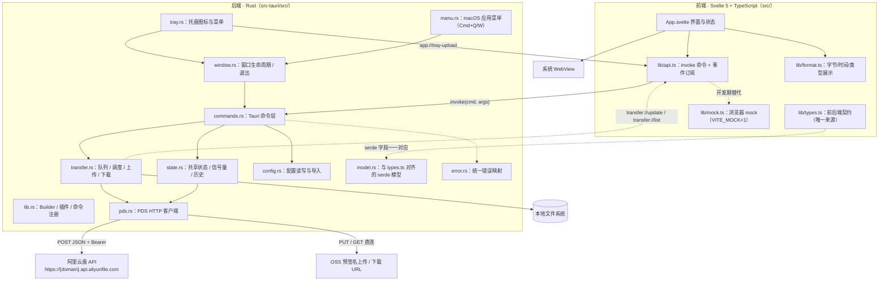
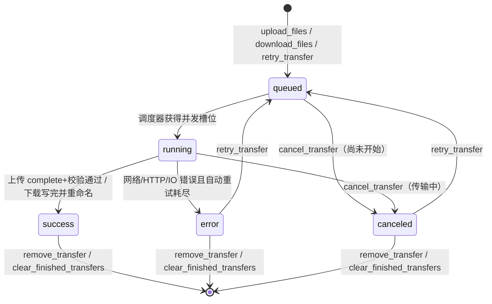
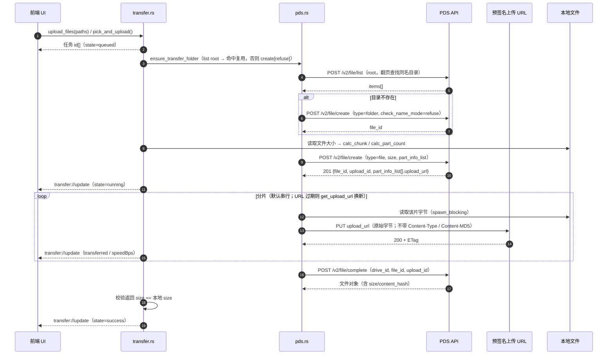

# 互联 · 架构设计

> 本文描述「互联」0.1.0 的实现架构与前后端契约。契约部分以 [`src/lib/types.ts`](../src/lib/types.ts) 与 [`src/lib/api.ts`](../src/lib/api.ts) 为准；云盘接口细节见 [PDS-API 契约](PDS-API契约.md) 与 [PDS-API 调研报告](PDS-API调研报告.md)。

## 目录

1. [设计目标与约束](#设计目标与约束)
2. [技术选型](#技术选型)
3. [总体架构](#总体架构)
4. [目录结构](#目录结构)
5. [前端分层](#前端分层)
6. [Rust 模块职责](#rust-模块职责)
7. [Tauri 命令契约](#tauri-命令契约)
8. [事件契约](#事件契约)
9. [传输状态机与重试语义](#传输状态机与重试语义)
10. [并发模型](#并发模型)
11. [上传与下载流程](#上传与下载流程)
12. [轻量常驻策略](#轻量常驻策略)
13. [配置与数据](#配置与数据)
14. [平台差异处理](#平台差异处理)
15. [安全设计](#安全设计)
16. [调试与测试](#调试与测试)
17. [未决问题与设计取舍](#未决问题与设计取舍)

---

## 设计目标与约束

「互联」是一个**手动触发**的跨端文件互传工具，架构围绕三条硬约束展开：

1. **不做后台常驻业务**：不监听本地目录、不扫描文件、不轮询云端列表、不定时同步。所有网络请求都由用户操作触发。
2. **轻**：常驻内存与安装包都要小。桌面端关闭窗口后只留系统托盘；空闲时不保留 WebView 进程、网络连接与定时任务。
3. **不引入自有服务端**：文件与账号数据只在本机与用户自己的阿里云盘之间流动；App 没有中转服务器、没有遥测。

由此带来的边界（也是有意为之）：

- 只有一个云盘账号、一个云端互传目录（导入时自动选默认空间）；
- 传输队列在内存中，只有**已结束记录的最近 100 条**落盘（`transfers.json`）；进行中任务不持久化，App 退出即中断；
- 云端删除不可用（API Key 权限 403，见 [受限接口](PDS-API契约.md#受限接口删除与回收站)），App 不提供删除入口；
- 不做文件分享链接、不做版本历史、不做多端同步冲突处理。

## 技术选型

| 维度 | Tauri 2（本方案） | Electron | Flutter |
| --- | --- | --- | --- |
| 安装包量级（桌面） | 个位数 MB ~ 十几 MB（复用系统 WebView，Rust 二进制 + 前端静态资源） | 约 80–150MB（需内置 Chromium + Node） | 约 20–40MB（需内置 Flutter 引擎） |
| 空闲常驻内存 | 低；销毁窗口后仅剩 Rust 主进程 + 托盘 | 高；每个窗口一个 Chromium/Node 进程 | 中等；引擎与渲染进程常驻 |
| 跨端一致性 | macOS / Windows / Linux / Android / iOS 一套前端与 Rust 后端 | 桌面成熟，移动端（Android）生态弱 | 三端 UI 一致，但桌面托盘/多窗口/自启需各平台插件 |
| 桌面系统能力 | 官方插件：托盘、自启、单实例、对话框、opener；Rust 侧可直接调系统 API | 成熟但依赖 Node 侧 API 与原生模块 | 需额外写平台通道（platform channel） |
| 移动端 | Tauri 2 官方支持 Android/iOS；本项目已用 `cfg(mobile)` 隔离平台代码 | 不适用 | 强项，但本项目更倚重 Rust 网络/文件能力 |
| 运行时依赖 | 依赖系统 WebView（Win10 1803+ 自带 WebView2；macOS WKWebView；Android System WebView） | 无（自带 Chromium），但包体大 | 无（自带引擎） |
| 本项目的适配度 | **高**：传输逻辑天然适合 Rust（分片、流控、文件 IO），UI 只是薄壳 | 中：为「轻量常驻」付出的包体/内存代价大 | 中：Android 好，但桌面托盘/窗口生命周期仍需额外工作 |

> 表中体积/内存为**量级估算**（基于同类项目的工程经验，非本仓库逐项基准测试），用于说明选型方向，不作为性能承诺。

**为什么是 Tauri 2：**

- 需求本质是「一个常驻托盘 + 一个轻量 UI + 一个可靠的传输引擎」，传输引擎落在 Rust（Tokio + reqwest），UI 复用系统 WebView，正好匹配「轻」的目标；
- 托盘常驻场景下，Electron 的 Chromium 常驻成本与「空闲近零占用」直接冲突；
- 官方插件覆盖托盘（`tray-icon`）、开机自启（`tauri-plugin-autostart`）、单实例（`tauri-plugin-single-instance`）、文件选择（`dialog`）、打开路径（`opener`），桌面端不用自己造轮子；
- 桌面与 Android 共用同一套 Rust 云盘/传输代码，窗口、托盘、自启、文件选择等平台差异用 `cfg(desktop)` / `cfg(mobile)` 内联隔离；
- PDS 没有官方 Rust SDK，但其协议足够简单（create → PUT × N → complete 三个调用），用 `reqwest` 手写客户端比引入 SDK 更可控、依赖更少。

## 总体架构



分层职责：

| 层 | 位置 | 职责 |
| --- | --- | --- |
| 展示层 | `src/App.svelte`、组件 | 渲染、交互、拖拽、选择文件；不直接发网络请求 |
| 前端接口层 | `src/lib/api.ts` | 统一封装 `invoke` 与 `listen`，提供 mock 分支；所有命令名/参数在此收口 |
| 契约层 | `src/lib/types.ts` | 前端类型 + 事件名常量；与 Rust `model.rs` 一一对应 |
| 命令层 | `src-tauri/src/commands.rs` | Tauri `#[tauri::command]`，参数校验、调用服务层、错误转字符串 |
| 领域层 | `transfer.rs`、`pds.rs`、`state.rs`、`config.rs` | 传输调度、PDS 协议、共享状态、配置与凭据 |
| 平台层 | `tray.rs`、`window.rs` | 托盘、窗口销毁/重建；移动端差异在命令层内联 `cfg` 处理 |
| 外部系统 | 阿里云盘 PDS API | 用户自己的云盘；无自建后端 |

## 目录结构

```text
互联/
├── README.md
├── package.json                  # 前端依赖与脚本（dev / build / tauri / dev:mock）
├── pnpm-lock.yaml
├── index.html                    # Vite 入口
├── vite.config.ts
├── svelte.config.js
├── tsconfig.json
├── assets/                       # 图标源文件（app-icon.png）
├── src/                          # 前端
│   ├── main.ts                   # 挂载 Svelte 应用
│   ├── App.svelte                # 单页界面（上传 / 下载 / 传输记录 / 设置）
│   ├── app.css                   # 全局样式与主题变量
│   └── lib/
│       ├── api.ts                # Tauri 命令封装 + 事件订阅（mock 分支）
│       ├── types.ts              # 前后端契约类型 + 事件名
│       ├── mock.ts               # 浏览器 mock 数据（VITE_MOCK=1）
│       ├── format.ts             # 展示格式化工具
│       ├── icons.ts              # 图标/色块等展示资源
│       ├── ui.ts                 # 交互小工具（toast/确认等）
│       └── state.svelte.ts       # Svelte 5 runes 状态
├── src-tauri/                    # Rust 后端
│   ├── Cargo.toml
│   ├── build.rs
│   ├── tauri.conf.json           # 产品名、窗口、bundle、图标、identifier
│   ├── capabilities/
│   │   ├── desktop.json          # macOS / Windows / Linux 权限
│   │   └── mobile.json           # Android / iOS 权限
│   ├── icons/                    # 打包图标（由 pnpm tauri icon 生成）
│   └── src/
│       ├── main.rs               # 入口（Windows 隐藏控制台）
│       ├── lib.rs                # Tauri Builder 装配、插件与命令注册
│       ├── model.rs              # serde 模型（对齐 types.ts）
│       ├── error.rs              # 统一错误类型与中文映射
│       ├── config.rs             # 配置读写、平台默认值、aliyun CLI 导入
│       ├── pds.rs               # PDS HTTP 客户端（鉴权/列表/上传/下载/分片计算）
│       ├── state.rs              # 共享状态 / 并发信号量 / 历史记录
│       ├── transfer.rs           # 传输队列与调度（上传/下载任务）
│       ├── commands.rs           # Tauri 命令层
│       ├── menu.rs               # macOS 应用菜单（Cmd+Q 退出 / Cmd+W 关窗）
│       ├── tray.rs               # 托盘（仅桌面端编译）
│       └── window.rs             # 窗口关闭/销毁/重建（仅桌面端编译）
├── scripts/
│   ├── env.sh                    # 项目内 Rust 工具链环境变量
│   ├── pds_probe.py              # PDS API 真机探针（只写 .cache/probe/）
│   ├── pds_upload_test.py        # 上传/下载/断点端到端验证脚本（Python 参考实现）
│   ├── gen_icon.py               # 图标生成辅助脚本
│   ├── build-macos.sh
│   ├── build-windows.ps1
│   └── build-android.sh
├── docs/
│   ├── 架构设计.md               # 本文
│   ├── 使用说明.md
│   ├── 构建与发布.md
│   ├── PDS-API契约.md
│   └── PDS-API调研报告.md        # 完整调研证据（认证/官方文档/秒传/并行/限流）
└── .github/workflows/build.yml   # 三端 CI
```

> Rust 源文件为平面布局（`pds.rs` / `transfer.rs` / `state.rs` / `commands.rs` / `tray.rs` / `menu.rs` / `window.rs`），不单独建 `mobile.rs`：移动端差异用 `cfg(mobile)` 在对应模块内联处理（文件选择在 `commands.rs` 内用 `tauri-plugin-fs` 复制 content URI）。模块职责边界以本文为准。

## 前端分层

- **`main.ts`**：`mount(App)`，零逻辑。
- **`App.svelte`**：单页应用。桌面 780×640、手机全屏响应式；主 Tab 为上传 / 下载（云端互传目录）/ 传输记录，设置抽屉承载账号与偏好。所有数据通过 `api.*` 获取，通过 `onTransferUpdate` / `onTransferList` / `onTrayUpload` 订阅更新。
- **`lib/api.ts`**：唯一允许 `invoke`/`listen` 的位置。`isMock = import.meta.env.VITE_MOCK === "1"`，mock 或非 Tauri 环境（纯浏览器）自动走 `lib/mock.ts`，因此 UI 可以脱离 Rust 开发。
- **`lib/types.ts`**：契约单一来源。变更任何字段都需要同步 `src-tauri/src/model.rs`；事件名常量也在这里。
- **`lib/format.ts`**：`formatBytes` / `formatSpeed` / `formatDuration` / `formatTime` / `timeAgo` / `fileKind`，纯展示逻辑。
- **`lib/state.svelte.ts` / `lib/ui.ts` / `lib/icons.ts`**：Svelte 5 runes 状态、交互反馈与图标/色块资源；均只依赖 `api.ts` 与 `types.ts`。
- **状态策略**：前端不缓存云端列表（无本地数据库）；窗口重建后通过 `get_config` + `list_transfers` 重新拉全量，云端列表等待用户主动刷新。

## Rust 模块职责

| 模块 | 职责 | 关键实现点 |
| --- | --- | --- |
| `lib.rs` | Builder 装配：插件、`manage(Shared)`、`invoke_handler`、托盘/菜单/窗口初始化、CLI 参数分发 | 全端注册 `tauri-plugin-fs`；桌面端注册 `tauri-plugin-autostart` / `tauri-plugin-single-instance`；处理 `--import-cli` / `--selftest` / `--hidden` |
| `model.rs` | 与 `types.ts` 一一对应的 serde 结构体 | `#[serde(rename_all = "camelCase")]`；`TransferItem.state` 以字符串序列化 |
| `error.rs` | 统一错误 `AppError`，序列化为中文可读字符串 | 401/403/404/429/5xx 分别映射；`is_retryable` / `is_upload_url_expired` 驱动重试策略 |
| `config.rs` | 读写 `AppConfig`、平台默认值、从 aliyun CLI 导入 | 配置存 `app_config_dir()/config.json`；Unix 下 chmod `0600`；导入读 `~/.aliyun/pds_config.json` 的 `current`/`profiles[0]` |
| `pds.rs` | PDS 客户端：Bearer 鉴权、公共请求头、错误码映射、`user_get` / `drive_get` / `drive_list` / `file_list` / `file_search` / `file_create` / `get_upload_url` / `list_uploaded_parts` / `file_complete` / `get_download_url` / 分片 `PUT` / `GET` | 上传 `PUT` **不设置 Content-Type**；API 超时 60s、分片 30min；分片算法 `calc_chunk` / `calc_part_count`（9000 片上限、100KiB–5GiB） |
| `state.rs` | 进程内共享状态：配置、PDS 客户端、任务表、任务并发信号量、历史记录 | `RwLock<AppConfig>`；`Semaphore::new(parallel_transfers)`；`persist_history()` 写 `transfers.json`（≤100 条已结束任务） |
| `transfer.rs` | 内存队列、调度、上传/下载任务、取消、重试、进度与速度 | 每任务 `Mutex<TransferItem> + AtomicBool cancel`；进度节流 180ms；上传串行分片；下载 `.hpart` 临时文件 + Range |
| `commands.rs` | 所有 `#[tauri::command]`，薄封装；参数以 camelCase 接收 | 命令名与 [`api.ts` 命令契约](#tauri-命令契约) 完全一致；桌面端用原生文件选择器，Android 用系统选择器 + `tauri-plugin-fs` 复制 content URI 到缓存 `picked-files/` |
| `tray.rs` | 托盘图标与菜单（打开主界面 / 快速上传… / 打开下载文件夹 / 退出互联）；左键单击切换窗口显示 | 仅 `not(mobile)` 编译；「快速上传…」由 Rust 端直接选文件、创建任务后再通知前端刷新 |
| `menu.rs` | macOS 自定义应用菜单：「互联 → 退出互联」Cmd+Q、「窗口 → 关闭窗口」Cmd+W、保留「编辑」菜单（Cmd+C/V） | 仅 macOS 编译；自定义 Quit 避免 Tauri 默认菜单的退出被「驻留托盘」逻辑拦下 |
| `window.rs` | 窗口创建/销毁/重建与退出：`closeToTray` 时销毁窗口驻留托盘，否则关窗即退出 | 销毁窗口释放 WebView 进程；macOS 同步切换 ActivationPolicy；托盘/命令按需重建窗口并拉全量状态 |

**共享状态（`Shared`）**：

- `config: RwLock<AppConfig>`：账号与设置；
- `client: RwLock<Option<Arc<PdsClient>>>`：配置变更后重建；
- `tasks: RwLock<Vec<Arc<Task>>>`：新任务在前；启动时从 `transfers.json` 载入历史；
- `sem: RwLock<Arc<Semaphore>>`：任务并发（`parallel_transfers`，clamp 1–6），改设置后重建；
- `quitting: AtomicBool`：退出流程标记。

## Tauri 命令契约

> 本表由 [`src/lib/api.ts`](../src/lib/api.ts) 与 [`src/lib/types.ts`](../src/lib/types.ts) 逐项对齐。命令名、参数 key、返回类型如有冲突，**以代码为准**并同步更新本表。

| 命令 | 参数（JS 侧） | 返回 | 平台 | 说明 |
| --- | --- | --- | --- | --- |
| `get_config` | — | `AppConfig` | 全端 | 读取本机配置（含账号与设置） |
| `save_config` | `config: AppConfig` | `AppConfig` | 全端 | 校验后落盘；联动客户端与并发信号量重建、托盘/自启 |
| `import_local_cli_config` | — | `ImportResult` | 桌面 | 从 `~/.aliyun/pds_config.json` 导入账号，自动 `user/get` 回填用户名、`drive/list` 选默认空间，再保存 |
| `test_connection` | `account?: PdsAccount \| null` | `ConnectionStatus` | 全端 | 传 `account` 时测该账号，否则用已保存账号；返回用户/空间/配额 |
| `get_drive_quota` | — | `DriveQuota` | 全端 | `POST /v2/drive/get` → 名称/已用/总量 |
| `list_remote` | — | `RemoteFile[]` | 全端 | 列出「文件互传」目录文件，`created_at` 倒序（自动翻页） |
| `list_remote_folders` | — | `RemoteFile[]` | 全端 | 列出互传目录下的子目录（目录浏览） |
| `list_folder` | `parentFileId: string` | `RemoteFile[]` | 全端 | 列出指定目录内容 |
| `upload_files` | `paths: string[]` | `string[]`（任务 id） | 全端 | 本地绝对路径入队上传；拖拽与普通选择共用 |
| `pick_and_upload` | — | `string[]`（任务 id） | 全端 | 打开系统文件选择器后入队：桌面端直接拿路径；Android 用系统选择器，经 `tauri-plugin-fs` 读取 content URI 并复制到缓存 `picked-files/` 再上传（未真机验证） |
| `download_files` | `files: { fileId, name }[]` | `string[]`（任务 id） | 全端 | 云端文件入队下载 |
| `list_transfers` | — | `TransferItem[]` | 全端 | 内存队列 + 最近 100 条历史；窗口重建后拉全量 |
| `cancel_transfer` | `id: string` | `void` | 全端 | 取消排队中/进行中的任务 |
| `retry_transfer` | `id: string` | `string`（任务 id） | 全端 | 失败/取消任务重新入队；上传会复用上传会话补传 |
| `remove_transfer` | `id: string` | `void` | 全端 | 移除已结束任务（不删本地文件） |
| `clear_finished_transfers` | — | `void` | 全端 | 清空已完成/失败/取消记录 |
| `open_path` | `path: string` | `void` | 桌面 | 用系统默认程序打开文件（`opener` 插件） |
| `reveal_in_folder` | `path: string` | `void` | 桌面 | 在 Finder/资源管理器中显示 |
| `open_download_dir` | — | `void` | 桌面 | 打开本地下载目录 |
| `get_app_info` | — | `AppInfo` | 全端 | 版本、平台、设备名、下载目录、`isDesktop` |
| `set_autostart` | `enabled: boolean` | `void` | 桌面 | 开机自启（`autostart` 插件）；移动端无入口 |
| `hide_main_window` | — | `void` | 桌面 | 隐藏到托盘：直接销毁窗口释放 WebView，托盘/命令可重建（移动端无需调用） |
| `show_main_window` | — | `void` | 桌面 | 显示/聚焦窗口（不存在则重建） |
| `quit_app` | — | `void` | 全端 | 立即退出（跳过托盘驻留） |

补充约定：

- 前端命令参数使用 **camelCase**（例如 `parentFileId`、`account`），Rust 命令用 `#[tauri::command(rename_all = "camelCase")]` 或等价方式接收；返回结构统一 camelCase。
- `endpoint` 允许用户只填 `bjxxxxx`、`bjxxxxx.api.aliyunfile.com` 或完整 URL，Rust 端 `normalize_endpoint()` 统一补全为 `https://...`。
- 所有命令失败时返回可展示的中文错误（`AppError` 序列化为 `String`），前端以 toast/行内错误呈现，不吞异常。
- `api.uploadDropped(paths)` 是 `upload_files` 的前端别名（拖拽后由 UI 直接把路径传进来），不是独立命令。

## 事件契约

| 事件名 | 方向 | Payload | 触发时机 | 备注 |
| --- | --- | --- | --- | --- |
| `transfer://update` | Rust → 前端 | `TransferItem` | 任务新增、状态变化、进度更新 | 进度按 180ms 节流合并；窗口不存在时发送失败可忽略，重开窗口用 `list_transfers` 补齐 |
| `transfer://list` | Rust → 前端 | `TransferItem[]` | 队列整体变化：新增、移除、清空、任务结束 | 前端用它替换整个列表 |
| `app://tray-upload` | Rust → 前端 | 无 | 托盘「快速上传…」在 Rust 端完成选文件并创建上传任务后广播 | 前端收到后刷新传输列表/提示；窗口不存在时 Rust 端会先重建窗口 |
| `app://request-quit` | Rust → 前端（预留） | 无 | 预留：退出前请求前端确认/清理 | `types.ts` 已定义常量；当前 `api.ts` 未订阅，属于预留契约 |

事件名常量集中在 `src/lib/types.ts`（`EVENT_TRANSFER_UPDATE` / `EVENT_TRANSFER_LIST` / `EVENT_TRAY_UPLOAD` / `EVENT_REQUEST_QUIT`），Rust 侧 `transfer.rs` 使用相同的 `transfer://update` / `transfer://list` 字符串。

## 传输状态机与重试语义



**状态语义（`TransferItem.state`）**

| 状态 | 含义 | 可执行操作 |
| --- | --- | --- |
| `queued` | 已入队，等待任务并发槽位 | 取消 |
| `running` | 正在传输，`transferred`/`speedBps` 持续更新 | 取消 |
| `success` | 完成（上传 = `complete` 成功且 size 校验通过；下载 = 全部字节写入并 rename） | 打开文件 / 移除 |
| `error` | 失败，`error` 字段含可读原因 | 重试 / 移除 |
| `canceled` | 用户取消 | 重试 / 移除 |

**重试语义（与 `transfer.rs` 实现一致）**

- **上传分片级自动重试**：单分片 PUT 失败最多重试 4 次，指数退避 `400ms × 2^n`（上限 8s）；网络类错误（`Http` / `Io` / 429 / 5xx）才重试，其它 4xx 直接失败。
- **上传 URL 过期**：403 `SignatureDoesNotMatch` / `AccessDenied` → 调 `get_upload_url` 换新 URL 后重该分片（**不重新 create**）。
- **上传会话失效**：`NotFound.UploadId` / `NoSuchUpload` 等 → 清空会话、重新 create，最多 3 轮。
- **上传任务重试**：失败/取消后点重试 → 回 `queued`；若内存里还保留上传会话，会先用 `list_uploaded_parts` 查已完成分片并补传（`transferred` 重置后按分片重算）。App 重启后会话丢失，只能从头上传。
- **下载自动重试**：`get_download_url` / GET / 写盘失败最多 3 轮，退避 400ms 起；重试时按 `.hpart` 临时文件已有字节发 `Range` 续传；服务端返回 416 时删除临时文件从头下载。
- **下载任务重试**：点重试直接重新进入下载流程，仍从 `.hpart` 续传（同一台机器、同一运行环境下）。
- **取消**：`cancel_transfer` 置任务 `AtomicBool` 取消位；网络等待通过 `tokio::select!` 中断（取消信号每 200ms 轮询）；任务最终落 `canceled`，已下载临时文件保留供重试。
- **不做无限重试**：自动重试有上限，超过即落 `error`，避免弱网下无限占资源。

## 并发模型

| 参数 | 默认值 | 可调范围 | 作用 |
| --- | --- | --- | --- |
| `parallelTransfers` | 2 | 1–6 | 同时处于 `running` 的任务数（跨文件） |
| `parallelParts` | **1（串行）** | 1–4（config 校验与引擎 clamp 一致） | 单个上传文件内部同时进行的分片数 |
| `chunkSizeMb` | 桌面 8 / 移动 4 | 1–64（MB） | 上传分片大小；超大文件自动放大以免超过 9000 片 |

- **为什么默认串行**：PDS 官方 JS SDK 为串行上传，服务端使用**流式计算 SHA1**，单文件分片不保证支持并行；并行模式需要每片提交 `parallel_sha1_ctx`（App 未实现）。因此默认 1 最稳，设置里调高属于实验项，可能失败。
- 任务并发由 `state.rs` 的 `Semaphore` 控制；改设置会重建信号量，只影响后续任务。
- 上传分片读取用 `spawn_blocking` 按 offset/len 精确读，不会把整文件读进内存。
- 进度事件按 **180ms** 节流；速度用 0.1s 窗口的瞬时值做 0.7/0.3 指数平滑（EWMA）。

## 上传与下载流程

### 上传（分片，默认串行）



边界情况：

- **0 字节文件**：`part_count = 0`，create 时不传 `part_info_list`，直接 `complete`。
- **秒传**：`create` 返回 `rapid_upload: true` 时跳过 PUT/complete；但 App 目前不传 `content_hash`，该分支不会触发（秒传未接入）。
- **同名文件**：文件用 `check_name_mode=auto_rename`（云端自动改名，不覆盖）；互传目录用 `refuse` + 先查复用（避免时间戳后缀目录堆积）。
- **分片规则**：分片数 = `ceil(size/chunk)`，除最后一片外等长，最后一片为余数；超过 9000 片自动放大 chunk。

### 下载（流式 + 断点）

1. `POST /v2/file/get_download_url`（`drive_id`、`file_id`、`expire_sec: 3600`）拿到签名 `url`（`method: "GET"`）。
2. 若临时文件 `<目标>.hpart` 已存在，取其长度作为 `transferred`，发 `Range: bytes=<transferred>-`（服务端 206）。
3. 流式写入临时文件，进度实时更新；URL 过期（403）或 416 时重新取地址/从头再来。
4. 写完后校验 `local >= size`，`rename` 成目标文件；目标同名时自动命名 `name (1).ext`，非法文件名字符替换为 `_`。
5. 失败最多自动重试 3 轮，仍失败落 `error`，用户点重试继续（临时文件保留）。

> 断点续传只在**单次任务/同一台机器**有效：`.hpart` 文件保留即可续传，但 App 重启后任务不会自动恢复（历史记录只保存已结束任务）。

## 轻量常驻策略

**1）关闭窗口的两种行为（由 `closeToTray` 决定）**

- **`closeToTray = true`（默认）**：点窗口红灯 / Cmd+W → `CloseRequested` 被拦截 → 销毁主窗口（释放 WebView 与界面内存）→ 进程留在托盘。
- **`closeToTray = false`**：不拦截关窗 → 窗口关闭后走正常退出流程（`ExitRequested` 放行），应用退出。
- **真正退出**：Cmd+Q（macOS 自定义 `menu.rs` 的「退出互联」）、托盘「退出互联」、`quit_app` 都会先标记 `quitting` 再 `app.exit(0)`，任何设置下都生效。
- **重建窗口**：托盘左键单击 / 「打开主界面」：窗口不存在则以相同 `label = "main"`、相同 URL 重建；前端启动流程重新执行（`get_config` + `list_transfers` + 订阅事件），因此不需要持久化 UI 状态。
- 传输由 Rust 主进程执行：`closeToTray = true` 时窗口销毁不影响已入队任务；窗口不存在时事件发送失败可忽略，重开窗口后以 `list_transfers` 补齐。
- **macOS 托盘态**：销毁窗口时切到 `ActivationPolicy::Accessory`（Dock 不显示图标、只留菜单栏托盘）；打开窗口前切回 `Regular`。
- **开机自启**：autostart 以 `--hidden` 参数启动；若 `closeToTray` 开启，则启动时不创建窗口、直接驻留托盘。
- **按需创建窗口（0.1.0 起）**：桌面端主窗口在平台配置 `src-tauri/tauri.macos.conf.json`、`src-tauri/tauri.windows.conf.json` 中设为 `"create": false`，由 `window.rs::show_main_window` 在需要时通过 `WebviewWindowBuilder` 创建；移动端沿用基础 `tauri.conf.json` 的窗口配置。因此 `--hidden` 启动路径**完全不会实例化 WebView**。

**2）没有「后台业务」**

- 不注册任何定时器 / `setInterval` / cron：云端列表只在用户点击刷新或首次进入下载页时拉取；
- 不监听文件系统、不扫描目录、不保留长连接（HTTP 客户端仅复用连接池，空闲无流量；`pool_idle_timeout = 90s`）；
- 空闲时进程只有托盘与 Tauri 事件循环，CPU 占用接近 0。

**3）体积与运行时优化**

- `Cargo.toml` 的 release profile：`opt-level = "s"`、`lto = true`、`codegen-units = 1`、`panic = "abort"`、`strip = true`；
- 前端不引入 UI 框架/组件库/CDN 资源，产物是纯静态小包；
- 桌面端使用 `tauri-plugin-single-instance`，重复启动只会唤起已有实例，避免出现多个托盘进程；

**4）实测数据（macOS 26 / Apple Silicon / 0.1.0 release 构建）**

| 场景 | `phys_footprint`（活动监视器「内存」） | RSS |
| --- | --- | --- |
| `--hidden` 托盘常驻（进程内从未创建 WebView） | ≈ 15 MB | ≈ 70 MB |
| 使用过一次后关闭窗口（销毁窗口，WebKit 框架页常驻） | ≈ 26 MB | ≈ 97 MB |
| 主窗口打开 | ≈ 31 MB | ≈ 103 MB |

- `.app` 5.29 MB、`.dmg` 2.68 MB；空闲 CPU ≈ 0%（进程启动 5 秒累计 CPU 时间 0.008 s）。
- 测量工具：`scripts/measure_footprint.c`（`proc_pid_rusage` / `ri_phys_footprint`），完整证据见 [实测与验证报告](实测与验证报告.md)。

**5）截至目前仍无法消除的开销**

- WebKit 框架在首次创建窗口后常驻进程地址空间（约 11 MB footprint），无法卸载；因此「用过一次后关窗」的常驻内存高于「从未打开」的纯托盘启动。
- macOS 窗口销毁后，系统的 CGWindow 列表里可能短暂保留一个不可见窗口记录（Tauri 侧 `webview_windows()` 已为 0），不影响功能与可见内存。
- 需要开机自启时使用 `tauri-plugin-autostart`（可选，关闭时不写系统自启项）；
- 数据层只有两个 JSON 文件（`config.json`、`transfers.json`），无数据库进程。

## 配置与数据

**配置文件**：`app.path().app_config_dir()/config.json`（Tauri identifier 为 `app.hulian.transfer`）：

- macOS：通常是 `~/Library/Application Support/app.hulian.transfer/config.json`；
- Windows：`%APPDATA%\app.hulian.transfer\config.json`；
- Android：应用私有目录。

Unix 下保存后会把文件权限收紧为 `0600`。**token 当前为明文保存**，未接入系统钥匙串（路线图）。

**`AppConfig`**

```ts
interface AppConfig {
  account: PdsAccount | null;
  settings: AppSettings;
}
```

`PdsAccount`：`endpoint`、`domainId`、`driveId`、`accessToken`，连接成功后回填 `userId` / `userName` / `driveName` 用于展示。

`AppSettings` 默认值与含义（范围以实现校验为准）：

| 字段 | 默认值 | 范围 | 说明 |
| --- | --- | --- | --- |
| `transferFolderName` | `文件互传` | 非空 | 云端根目录下的互传目录名，首次使用时自动创建 |
| `downloadDir` | 桌面为系统下载目录下的「互联」；移动端为 App 数据目录下 `Downloads` | 非空 | 本地下载位置 |
| `chunkSizeMb` | 桌面 8 / 移动 4 | 1–64 | 上传分片大小（MB） |
| `parallelParts` | 1 | 1–4 | 单文件分片并发；默认串行最稳（PDS 服务端流式计算 SHA1，官方要求串行） |
| `parallelTransfers` | 2 | 1–6（设置页提供 1–4） | 同时传输的任务数 |
| `autostart` | `false` | — | 开机自启（桌面端） |
| `closeToTray` | `true` | — | 关闭窗口时驻留托盘（桌面端）；`false` = 直接退出 |
| `deviceName` | 系统名（如 `Mac · 演示用户` / `Windows · 演示用户`） | 非空 | 本机设备名，用于传输记录标注 |
| `theme` | `dark` | `dark` / `light` / `system` | 主题 |

**历史记录**：`config.json` 同目录的 `transfers.json`：

- 只保存**已结束**任务（`success` / `error` / `canceled`），最多 100 条，新的在前；
- 启动时载入为历史记录，**进行中/排队任务不保存**（App 退出即中断，不跨重启续传）；
- 每次任务结束、移除、清空都会重写该文件；不含文件内容与 token。

**传输队列**：只在内存（`Vec<Arc<Task>>`），不引入数据库；`clear_finished_transfers` 清空已结束任务并同步历史文件。

## 平台差异处理

| 能力 | macOS | Windows | Android |
| --- | --- | --- | --- |
| 窗口 | 原生窗口；关闭即销毁（托盘驻留） | 原生窗口；同左 | 单 Activity 全屏；无「关窗驻留」概念 |
| 托盘 | ✅（模板图标，适配深浅色） | ✅（系统托盘区） | ❌ 无托盘 |
| 开机自启 | ✅（LaunchAgent，autostart 插件） | ✅（注册表 Run 项，autostart 插件） | ❌ |
| 单实例 | ✅ | ✅ | 不适用（系统单 Activity） |
| 文件选择 | 原生对话框（dialog 插件），直接拿路径 | 原生对话框，直接拿路径 | 系统文件选择器（SAF，dialog 插件）→ `tauri-plugin-fs` 读 content URI → 复制到 App 缓存 `picked-files/` → 上传（未真机验证） |
| 下载位置 | 系统下载目录/互联 | `%USERPROFILE%\Downloads\互联` | 应用数据目录下的 `Downloads` |
| 打开/定位文件 | ✅ opener | ✅ opener | 受限，入口按平台隐藏 |
| WebView | 系统 WKWebView | WebView2（Win10 1803+ 自带或安装 Evergreen 运行时） | 系统 WebView |
| 打包 | `.app` + `.dmg` | NSIS `.exe`（可加 MSI） | APK（debug 签名）/ AAB |

**条件编译边界**

- `#[cfg(desktop)]` / `#[cfg(mobile)]`：托盘菜单、窗口关闭拦截、自启、单实例、`open_path` / `reveal_in_folder`、文件选择实现；不单独建 `mobile.rs`，差异在对应模块内联处理。
- `tauri.conf.json` 的窗口配置与 bundle targets 以桌面端为主；Android 使用 `tauri android` 子命令构建，不走 `bundle.targets`。
- capabilities 分两套：`desktop.json`（macOS / Windows / Linux，含 `autostart:default`、拖拽权限）与 `mobile.json`（Android / iOS，只保留 core/opener/dialog），确保移动端不会请求桌面专属权限。

## 安全设计

- **凭据**：token 只在本机配置文件与会话内存中；不写入日志、不随错误信息透出（错误信息里 URL 与 token 需截断）。导入 CLI 配置时只读取必要字段。
- **权限最小化**：Tauri 2 capabilities 按平台拆分；前端只能调用注册过的命令，不能任意访问文件系统/系统 API。
- **资源来源**：前端不加载远程脚本、不使用 CDN；`tauri.conf.json` 当前 `csp = null`（仅本地资源，风险可控），后续建议收紧为显式 CSP（路线图）。
- **传输安全**：所有 API 走 HTTPS；上传/下载使用 OSS 预签名 URL，有效期短（上传 URL 约 1h、下载 URL 默认 1h）；不把预签名 URL 持久化。
- **隐私**：无遥测、无统计、无广告；文件不经过开发者服务器。

## 调试与测试

| 场景 | 命令 | 说明 |
| --- | --- | --- |
| 只调 UI（无需 Rust、不碰真实云盘） | `pnpm dev:mock` | 浏览器打开 `http://localhost:1420`，mock 数据与模拟进度 |
| 类型检查 | `pnpm check` | `svelte-check` |
| 前端构建 | `pnpm build` | Vite 产物到 `dist/` |
| Rust 单元测试 | `source scripts/env.sh && cargo test --lib --manifest-path src-tauri/Cargo.toml` | `pds.rs` / `transfer.rs` 内分片、文件名、错误解析、URL 过期等单测（不联网） |
| Rust 真机联调（上传/下载） | `source scripts/env.sh && cargo test --lib -- --ignored live_` | 需要本机 `~/.aliyun/pds_config.json` 凭据；`#[ignore]` 用例默认跳过，CI 不运行 |
| App 内置自检 | `"/Applications/互联.app/Contents/MacOS/互联" --selftest` | 真实上传→下载→字节比对，成功输出 `SELFTEST_UPLOAD_DOWNLOAD OK` 后退出 |
| 命令行导入凭据 | `"/Applications/互联.app/Contents/MacOS/互联" --import-cli` | 从本机 aliyun CLI 配置导入账号并退出（排障/首次配置） |
| 桌面开发模式 | `pnpm tauri dev` | 需 Rust；`source scripts/env.sh` 后可用项目内工具链 |
| PDS 真机探针 | `python3 scripts/pds_probe.py` | 读取 `~/.aliyun/pds_config.json`，响应脱敏后写入 `.cache/probe/`；会在云端创建 `_互联探针` 目录（删除接口受限，可能残留） |
| 上传/下载端到端验证 | `python3 scripts/pds_upload_test.py` | Python 参考实现：分片上传 → 下载 → SHA-256 比对 → Range/断点续传验证 |
| 三端构建 | `bash scripts/build-macos.sh` 等 | 见 [构建与发布](构建与发布.md) |

## 未决问题与设计取舍

1. **Android / iOS 真机验证**：Android 的上传（SAF → 缓存副本）、下载、后台存活尚未真机验证；iOS 未适配（项目目标仅 macOS / Windows / Android）。
2. **分片并发**：官方要求串行（服务端流式 SHA1）；`parallel_parts > 1` 的可行性未实测，当前实现按最多 4 路并发处理，设置建议保持 1。
3. **移动端缓存清理**：Android 上传会在 App 缓存 `picked-files/` 留副本，目前依赖系统清理；后续可加「上传成功后删除临时副本」或容量上限策略。
4. **token 安全存储**：当前指标是「轻」，未引入钥匙串/Keystore；若后续多账号或共享设备场景出现，再补。
5. **跨重启续传**：上传会话与下载断点都只在内存/临时文件里；是否落盘「断点清单」并与历史记录合并，待产品决策（保持轻量 vs 体验）。
6. **超大文件**：> 9000 片时自动放大分片，理论支持到约 48TB（5GiB × 10000），实际受空间配额限制；超大文件的耗时与内存表现未实测。
7. **分享链接投递**：`share_link/create` 可用（调研已验证），可作为「不共享 API Key 的 P2P 投递」方案，但会增加产品复杂度，暂列路线图。
8. **Windows 签名/公证与实机验证**：未签名产物会触发 SmartScreen；正式分发需证书。
